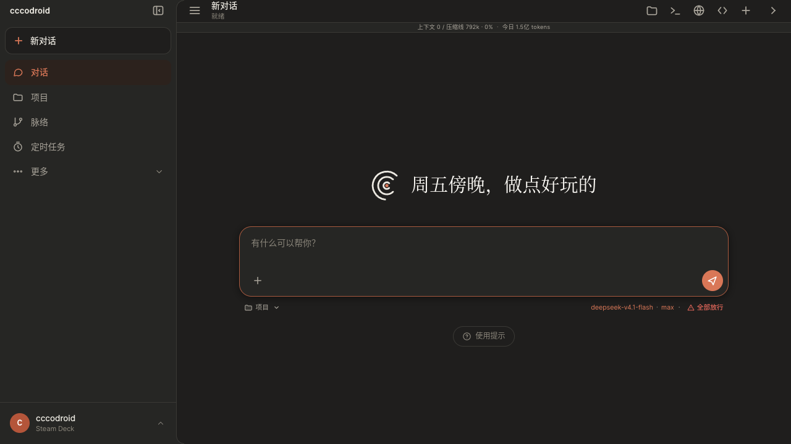

# cccodroid-linux：cccodroid 的 Steam Deck / SteamOS 原生移植

把 [cccodroid](https://github.com/greyoak111/cccodroid)（Claude Code 图形工作台）以原生 Linux 桌面应用的方式运行在
SteamOS / Arch 系桌面上：一个 Qt6 原生窗口、一套 systemd 用户服务、一个不需要 root 的安装脚本。
面向 SteamOS 专门优化前端体验，也支持普通 Arch 桌面。

**本项目是社区移植，不是 cccodroid 官方项目。** 上游版权归 Grey Oak 与 cccodroid 贡献者所有，详见「致谢」。

**产品标识：`cccodroid Steam Deck 0.1.4`。** 这里的 `0.1.4` 是移植版自己的版本号，不是上游 cccodroid 的版本号；
上游目前是 0.6.x。看到 `0.1.4` 时请认准 `Steam Deck` 这个标识。



## 在 Steam Deck 上，它到底能帮你干什么

Steam Deck 的麻烦往往不在「不会用」，而在三件事：装 Decky 插件被管理员密码和版本问题绕晕、装软件被只读文件系统挡回来、出错后只有一句看不懂的英文报错。

| 最痛的事 | cccodroid 怎么帮 |
| --- | --- |
| **装插件**：Decky 安装涉及管理员密码，SteamOS 更新后还可能消失 | 先读 SteamOS / Decky 版本和 `~/homebrew` 状态，判断是没装好、版本旧还是插件不兼容，再给对应步骤 |
| **装软件**：根分区只读，`pacman` 装的包系统更新后就没了 | 先判断该走 Flatpak / AppImage / Distrobox；不需要 root 的直接装，需要 root 的把命令和风险讲清楚 |
| **看报错**：英文、很长、网上教程对不上版本 | 结合你的命令、日志、已装包解释原因，并去查当前版本有没有已知修法 |

cccodroid 里跑的是 Claude Code，一个带工具的 agent，不是只会聊天的窗口。它能：

- **在你机器上执行命令**（Bash）：查系统版本、跑 flatpak、看日志、解压插件包，并读回输出和退出码；
- **读写文件**：改配置、看日志、批量整理 mod 和存档；
- **搜网页 / 读文档 / 查 GitHub issue**：对着一句报错找同款案例，核对它适用于哪个 SteamOS 版本；
- **写小脚本、批量整理 Mod / 存档 / 下载目录**，或者管 Git 仓库、开子代理并行调查、用工作台的定时任务（比如每周备份存档）；
- **操作 cccodroid 自己的界面**（页面操控 MCP `ccui`）：读屏、点按、输入、滚动、截图。

所以它给的不是「一段网上一搜就有的命令」，而是：先看你机器上到底是什么版本、什么状态，再决定下一步；命令报错了，它能读报错继续修。需要 sudo 的步骤（装 Decky、解锁 pacman）它不会替你输密码，但会把命令逐行解释清楚，由你确认后执行。

详细场景、提示词写法和常见报错对照见 **[Steam Deck 使用指南](docs/STEAMDECK.zh-CN.md)**。

## 特性

- **原生窗口**：Qt6 WebEngine 外壳（`desktop/main.qml`），窗口缩放/全屏/大小记忆、下载与文件选择、控制台日志。
- **应用内终端**：xterm.js 终端面板（最多 8 个），跑命令不用切到 Konsole。
- **Steam 游戏模式**：`cccodroid steam add` 登记 Steam 快捷方式，手柄映射与 kiosk 启动。
- **桌面通知**：任务完成、等你确认、定时任务结果（`notify-send`）。
- **会话迁移**：`cccodroid export` / `import`，支持 zip、标准输入、URL、`用户@主机:路径`，可撤销。
- **内置 OpenAI 本地协议桥**：把自有的 OpenAI Chat Completions 接口适配成本机 Anthropic Messages 接口，
  作为自定义接口使用（组件来自 [cccodroid-openai-bridge](https://github.com/chenshi723/cccodroid-openai-bridge)，可选，需自备上游 API Key）。
- **页面操控 MCP（ccui）**：Claude 可以读取原生窗口里的页面、点按、输入、滚动、截图，用来操作 cccodroid 自己的界面
  和应用内浏览器窗格。
- **扩展页的组件 / 自定义组件（Linux 版）**：检测并安装 Linux 可用的组件（无头 Chromium、FFmpeg、yt-dlp 等），
  也可以导入 x86_64 程序 / AppImage / 脚本，自动生成命令和 Claude 技能。上游的 Termux/arm64 组件包不会硬塞给 Deck。
- **更新链路**：本地文件 / 在线更新、发布签名校验、`rollback` 回退、旧版本清理；
  设置 → 更新里可以检查 cccodroid 本体（GitHub Releases）和 Claude Code，Claude Code 支持自动更新。

## 不包含

- **Claude Code 本体**：Claude Code 是 Anthropic 的专有软件，本仓库与发行包**都不包含**、也不再分发它的二进制或源码。
  请从 Anthropic 官方渠道安装并遵守其条款；本移植只调用你本机已安装的 CLI。
- API Key、模型额度、任何账号凭据。

## 下载安装（推荐）

> 第一次用 Linux / Steam Deck？看 **[大白话安装教程](docs/INSTALL.zh-CN.md)**，一步步照着做就行。

到 [Releases](https://github.com/FatBrother1/cccodroid-linux/releases) 下载
`cccodroid-0.1.4-linux-x86_64.tar.gz`（附 `.sha256` 与 `.sig`）：

```bash
tar -xzf cccodroid-0.1.4-linux-x86_64.tar.gz
cd cccodroid-0.1.4
./install.sh            # 不需要 root；装到 ~/.local/share/cccodroid
cccodroid status
cccodroid open          # 打开原生窗口
```

要求：x86_64 Linux（SteamOS 3.x / Arch 系桌面），Qt6 WebEngine（SteamOS 自带），可选 systemd 用户会话。

**Claude Code 不随包分发**（Anthropic 专有软件）。首次 `install.sh` 会从 npm 官方平台包
`@anthropic-ai/claude-code-linux-x64` 安装到应用自己的运行时目录（验签 + sha512 校验，约 110 MB），
需要能访问 npm 源；装不上时之后再运行 `cccodroid install-claude` 重试，离线环境用
`cccodroid install-claude --from /路径/claude`。

### Debian / Ubuntu 的一键 .deb

`.deb` 单独发布在 [v0.1.4-deb](https://github.com/FatBrother1/cccodroid-linux/releases/tag/v0.1.4-deb)。Debian / Ubuntu（amd64）也可以直接装，系统装到 `/opt/cccodroid`，首次运行 `cccodroid` 时为当前用户初始化：

```bash
sudo apt install ./cccodroid_0.1.4_amd64.deb
cccodroid open
```

卸载：`sudo apt remove cccodroid`（用户数据在 `~/.local/share/cccodroid`，需自行删除）。

> **SteamOS 是 Arch 系、根分区只读，不能用 .deb**；Steam Deck 请用上面的 tar.gz 安装包。

更细的安装、更新、回滚、卸载说明见 [`cccodroid-linux/README.zh-CN.md`](cccodroid-linux/README.zh-CN.md)。

## 从源码构建

`cccodroid-linux/build-bundle.sh` 负责把一份「已能在 Linux 上跑」的部署目录打成离线发行包。构建需要的运行时
（Node 26 x86_64、Claude Code 官方二进制）由构建者自行准备，**不随仓库分发**：

```bash
# 目录形态见 build-bundle.sh 头部注释
bash cccodroid-linux/build-bundle.sh \
  --source /path/to/stage \        # 含 src/、runtime/node/、runtime/claude
  --scripts-dir cccodroid-linux \
  --out dist
```

网关源码的移植改动在 [`docs/PORTING.md`](docs/PORTING.md) 里说明；与上游同步的流程见下。

## 与上游同步

- 上游：<https://github.com/greyoak111/cccodroid>（Apache-2.0）
- 本移植基线：上游 **v0.6.20**（提交写在 `UPSTREAM-BASE`），做 Linux 适配、Android 专属功能移除，
  并加入本地桥与页面操控 MCP。
- 本仓库是**移植快照，不是 GitHub fork**，不能直接点「Sync fork」。上游发新版后的流程：
  1. `bash scripts/sync-upstream.sh`：拉 `upstream/main`，把基线以来的网关改动写到 `dist-upstream/`；
  2. 按 [`docs/UPSTREAM.md`](docs/UPSTREAM.md) 把改动重放进 `src/gateway/`（保留 Linux 适配与 Android 功能移除）；
  3. 重建发行包、跑验收，最后更新 `UPSTREAM-BASE`。
- 版本：项目与应用统一为 `0.1.4`。

## 致谢

- **[cccodroid](https://github.com/greyoak111/cccodroid)** —— Grey Oak 与所有贡献者。没有上游就没有这个移植；
  本项目只做 Linux 适配和外围功能，界面与网关逻辑的绝大部分来自上游（Apache-2.0）。
  应用图标也来自上游（`android/res/mipmap-xxxhdpi/ic_launcher.png`）。
- **[cccodroid-openai-bridge](https://github.com/chenshi723/cccodroid-openai-bridge)** —— chenshi723（MIT），
  以及它依赖的 [Claude Code Router](https://github.com/musistudio/claude-code-router)（MIT）。
- 网页端第三方库（xterm.js、pdf.js、KaTeX、highlight.js、eruda 等）与上游一致，许可见各文件与 `NOTICE`。

## 许可

本仓库的移植代码以 Apache-2.0 发布（见 `LICENSE`）；上游与第三方组件的许可见 [`NOTICE`](NOTICE) 与 `vendor/`、
`cccodroid-linux/` 内的许可证文件。
